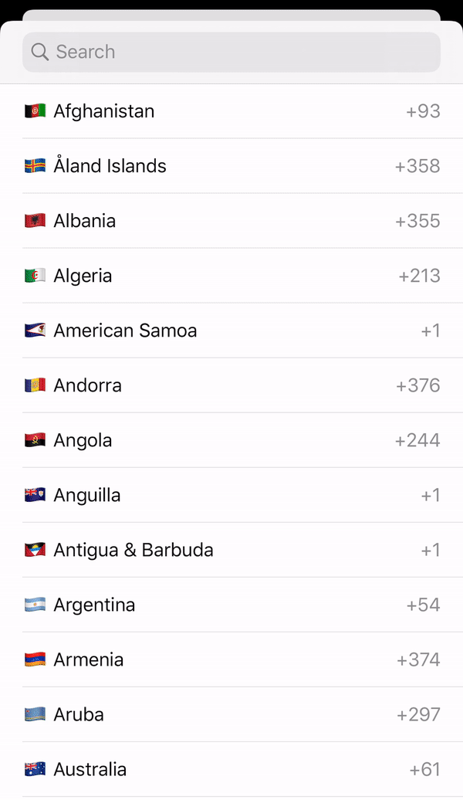
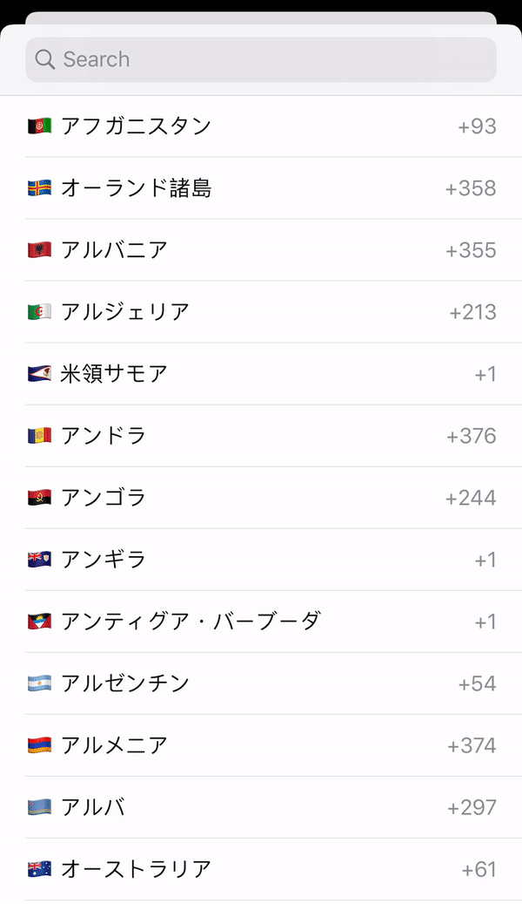

# DialCountries-SPM

[](https://swift.org/package-manager/)
[](https://developer.apple.com/ios/)
[](https://swift.org)
[](LICENSE)

A lightweight Swift country picker for iOS, packaged for **Swift Package Manager**.
Gives you the country name, ISO 3166 country code, flag emoji and international dialing code, plus a ready-made searchable picker screen.

## Features

- Searchable country list (by country name, ISO code or dial code)
- Country names in any language (pass a `Locale`)
- Flag emoji for every country
- Dark mode support
- Detect the user's current country
- Works with Swift Package Manager and CocoaPods

## Screenshots

| English | Japanese |
|---|---|
|  |  |

## Requirements

- iOS 13.0+
- Swift 5.5+
- Xcode 13.0+

## Installation

### Swift Package Manager (recommended)

**Xcode:** File → Add Package Dependencies… and enter:

```
https://github.com/opendhihyperlocal/DialCountries-SPM.git
```

Choose version `1.0.0` or later, then add the **DialCountries** library to your app target.

**Package.swift:**

```swift
dependencies: [
    .package(url: "https://github.com/opendhihyperlocal/DialCountries-SPM.git", from: "1.0.0")
],
targets: [
    .target(
        name: "YourApp",
        dependencies: [
            .product(name: "DialCountries", package: "DialCountries-SPM")
        ]
    )
]
```

### CocoaPods

```ruby
pod 'DialCountries', :git => 'https://github.com/opendhihyperlocal/DialCountries-SPM.git', :tag => '1.0.1'
```

## Usage

```swift
import DialCountries
```

### Show the country picker

```swift
let controller = DialCountriesController(locale: Locale(identifier: "en"))
controller.delegate = self
controller.show(vc: self)
```

### Handle the selection

```swift
extension ViewController: DialCountriesControllerDelegate {
    func didSelected(with country: Country) {
        print(country.flag)      // 🇮🇳
        print(country.name)      // India
        print(country.code)      // IN
        print(country.dialCode)  // Optional("+91")
        print(country.title)     // 🇮🇳 India
    }
}
```

### Get the current country

```swift
if let country = Country.getCurrentCountry() {
    print(country.title, country.dialCode ?? "")
}
```

## `Country` API

| Property | Type | Description |
|---|---|---|
| `code` | `String` | ISO 3166-1 alpha-2 code, e.g. `IN` |
| `name` | `String` | Localized country name |
| `flag` | `String` | Flag emoji |
| `title` | `String` | Flag + name, e.g. `🇮🇳 India` |
| `dialCode` | `String?` | Calling code, e.g. `+91` |

## Maintainer

[opendhihyperlocal](https://github.com/opendhihyperlocal)

## License

Available under the MIT license. See [LICENSE](LICENSE) for details.

Based on [DialCountries](https://github.com/ahmedAlmasri/DialCountries) by Ahmad Almasri.
